 

 

[About](#-a-little-about-me) · [Stack](#-the-toolkit) · [Projects](#-things-im-building) · [Open Source](#-open-source--collaboration) · [Stats](#-github-in-motion)

## ◈ A little about me

Hey, I'm **Haseeb** — a Computer Science undergraduate at **IIIT Tiruchirappalli**, interested in the engineering behind useful, reliable software.

I like taking ideas beyond the demo: exploring unfamiliar codebases, debugging edge cases, building tools, and improving how software behaves in the real world. Lately, a lot of that curiosity has been around **AI agents, computer-use workflows, Python, and developer productivity**.

> **Learn → Build → Debug → Contribute → Ship**

## ◈ The toolkit

*Currently going deeper into Python engineering, AI agents, automation, testing, and open-source workflows.*

## ◈ Things I'm building

<table>
<tr>
<td width="50%" valign="top">

### ◉ [Ruby — AI Screen Assistant](https://github.com/Syed-Haseeb97/ai_agent)

A Windows desktop assistant exploring the loop between perception, reasoning, and action.

- Gemini-powered responses
- Floating plasma-orb interface
- Voice input and speech output
- Screen awareness and desktop actions
- Browser automation and multi-step workflows

</td>
<td width="50%" valign="top">

### ◉ [Quit Addiction](https://github.com/Syed-Haseeb97/quit_addiction)

An Android experiment focused on making Instagram less distracting and keeping the experience centered on direct messages.

- DM-focused WebView experience
- Reels/feed distraction reduction
- Android UI and behavior refinement
- Iterative testing and regression fixes

</td>
</tr>
</table>

**More than building solo projects:** I'm also interested in making existing software better through careful, reviewable contributions.

## ◈ Open source & collaboration

I enjoy the real work behind a contribution: understanding unfamiliar code, reproducing a problem, writing a focused fix, and checking that it doesn't break something else.

- [Gutenberg — openzim](https://github.com/openzim/gutenberg) · exploring and contributing to an established codebase.
- [career-ops](https://github.com/career-ops/career-ops) · test and workflow improvements through pull requests.

See my [public repositories](https://github.com/Syed-Haseeb97?tab=repositories) and [contributions](https://github.com/Syed-Haseeb97?tab=contributions) for the latest work.

## ◈ GitHub in motion

  
  

  

### ◈ Find me around the web

<a href="https://www.linkedin.com/in/syed-haseeb-bukhari-a6a6961a">LinkedIn</a> · <a href="https://x.com/its_Haseebexe">X</a> · <a href="mailto:syed424892@gmail.com">Email</a>

 

*Curiosity is the spark. Consistent shipping is the current.*

