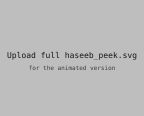

 

# SYED HASEEB BUKHARI

**Computer Science · IIIT Tiruchirappalli '30**

building products &nbsp;·&nbsp; future entrepreneur

 

  
  
  
  

---

### About

I'm **Haseeb** — a CSE undergrad who likes building things that actually work.

Drawn to the intersection of **AI agents, Python engineering, desktop automation, and developer experience**. I enjoy the full loop: understand a system, find the real failure, make a focused change, and verify it holds up.

Currently sharpening fundamentals by building, debugging, and contributing to real codebases.

### Selected build

**[Ruby / AI desktop companion](https://github.com/Syed-Haseeb97/ai_agent)**  
Personal desktop assistant exploring how an AI can move from conversation toward useful on-screen workflows. Python · Gemini · Windows · UI experiments.

### Skills & focus

`Python` `testing` `systems` `desktop automation` `Git` `FastAPI`

Also exploring Gemini-powered workflows, browser automation, and open-source maintenance.

---

*The best way to learn is to ship, inspect, and ship again.*

**Have a useful problem to solve? Let's talk.**

