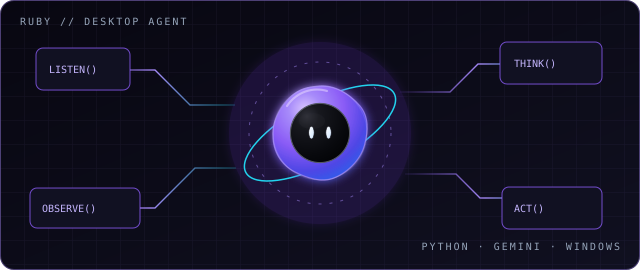

  
  
  

**Computer Science undergraduate · IIIT Tiruchirappalli**

*Building software that feels thoughtful, not just functional.*

<table>
<tr>
<td width="58%" valign="top">

## / 00 — The signal

I'm **Haseeb** — a CSE student drawn to the intersection of **AI agents, Python engineering, desktop automation, and developer experience**.

I like the whole loop: understand an unfamiliar system, find the real failure, make a focused change, and test whether it actually holds up. I care about the invisible work behind good software: edge cases, lifecycle behavior, clear interfaces, and honest verification.

Currently sharpening my engineering fundamentals by building, debugging, and contributing to real codebases.

</td>
<td width="42%" valign="top">

### CURRENT OPERATING MODE

| | |
|:--|:--|
| **Learning** | Python · testing · systems |
| **Exploring** | AI-assisted desktop workflows |
| **Building** | Tools with a clear purpose |
| **Approach** | Reproduce → fix → verify |

 

NOT HERE TO COLLECT BADGES. HERE TO GET BETTER AT THE WORK.

</td>
</tr>
</table>

## / 01 — Selected builds

These are ongoing engineering experiments. The goal isn't to pretend they're finished products; it's to make them more useful and reliable with every iteration.

<table>
<tr>
<td width="50%" valign="top">

### <a href="https://github.com/Syed-Haseeb97/ai_agent">Ruby / AI desktop companion ↗</a>

PYTHON · GEMINI · WINDOWS · UI ENGINEERING

A personal desktop assistant exploring how an AI can move from conversation toward useful on-screen workflows.

- A floating plasma-orb interface with a distinct visual identity
- Voice, screen context, and desktop interaction experiments
- Reliability work around popup behavior, lifecycle, and input handling
- Small, testable fixes instead of sweeping rewrites

<a href="https://github.com/Syed-Haseeb97/ai_agent">OPEN REPOSITORY →</a>

</td>
<td width="50%" valign="top">

### <a href="https://github.com/Syed-Haseeb97/quit_addiction">Quit Addiction / Focus-first Android ↗</a>

ANDROID · WEBVIEW · UX · REGRESSION TESTING

A digital-wellbeing experiment that reshapes Instagram access around direct messages instead of the endless feed.

- DM-focused navigation and WebView behavior
- Attempts to prevent accidental entry into distracting surfaces
- Interface preferences and interaction details
- Regression checks for navigation and build/install issues

<a href="https://github.com/Syed-Haseeb97/quit_addiction">OPEN REPOSITORY →</a>

</td>
</tr>
</table>

## / 02 — The workshop

<table>
<tr>
<td width="33%" valign="top">

**01 / Build**

Python, API fundamentals, desktop interfaces, Android experiments, and practical automation.

</td>
<td width="33%" valign="top">

**02 / Investigate**

Reproducing bugs, reading unfamiliar code, tracing UI state, and understanding failure modes.

</td>
<td width="33%" valign="top">

**03 / Verify**

Focused tests, regression checks, CI feedback, and checking behavior rather than assuming it works.

</td>
</tr>
</table>

ALSO EXPLORING: GEMINI-POWERED WORKFLOWS · BROWSER AUTOMATION · OPEN-SOURCE MAINTENANCE

## / 03 — Outside my own repos

I’m interested in contributing where it matters: learning an existing project's conventions, keeping changes narrow, and leaving the codebase easier to trust.

- **[openzim / gutenberg ↗](https://github.com/openzim/gutenberg)** — exploring and working within an established open-source project.
- **[career-ops / career-ops ↗](https://github.com/career-ops/career-ops)** — workflow and test-focused improvements.
- **[Browse all repositories ↗](https://github.com/Syed-Haseeb97?tab=repositories)** — the full, evolving workshop.
- **[Contribution activity ↗](https://github.com/Syed-Haseeb97?tab=contributions)** — work in progress, not just polished snapshots.

## / 04 — Live telemetry

  

  

Stats are provided by external services and may occasionally be unavailable or delayed.

### The best way to learn is to ship, inspect, and ship again.

**Have a useful problem to solve? Let's talk.**

<a href="https://www.linkedin.com/in/syed-haseeb-bukhari-a6a6961a">LINKEDIN</a> &nbsp;·&nbsp;
<a href="https://x.com/its_Haseebexe">X</a> &nbsp;·&nbsp;
<a href="mailto:syed424892@gmail.com">EMAIL</a>

 

HASEEB / CSE · IIIT TIRUCHIRAPPALLI / END OF TRANSMISSION

